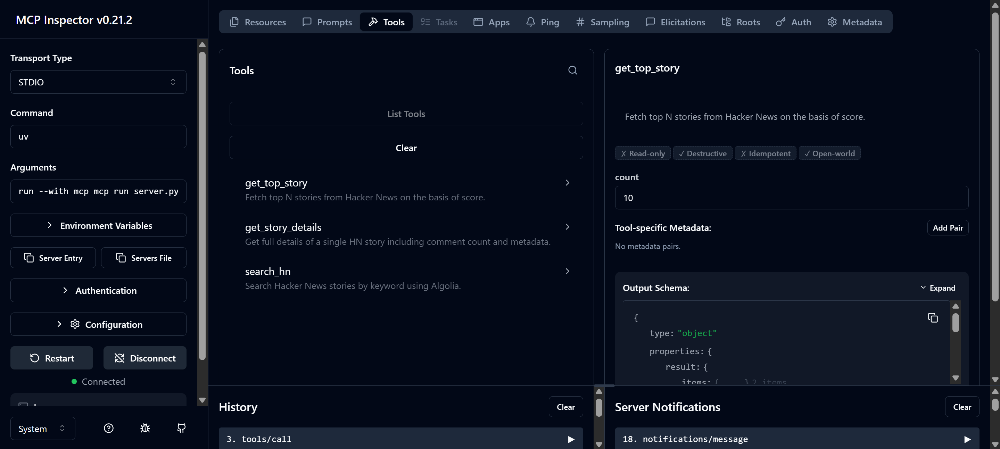
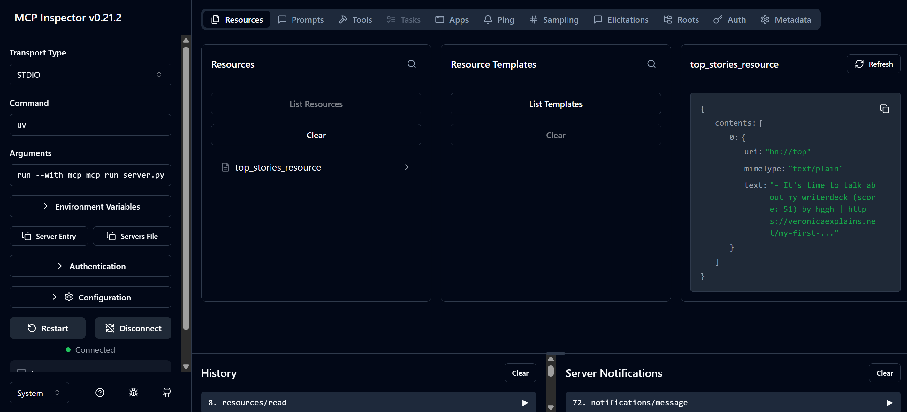

# hn-mcp-server

An MCP server that exposes Hacker News as tools and resources — callable by any MCP client (Claude Desktop, Cursor, Claude Code).

Built with the official Python `mcp` SDK. No API keys required.

---

## Demo




---

## MCP Primitives

### Tools

| Tool | Description | Arguments |
|---|---|---|
| `get_top_story` | Fetch top N HN stories by score | `count: int = 10` |
| `get_story_details` | Full details of a single story | `story_id: int` |
| `search_hn` | Search HN via Algolia by keyword | `query: str`, `count: int = 10` |

### Resources

| URI | Description |
|---|---|
| `hn://top` | Top 5 HN stories as plain text context |



### Prompts

| Name | Description |
|---|---|
| `hn_briefing` | Morning briefing prompt — instructs the LLM to fetch and summarize top stories |

---

## Setup

```bash
git clone https://github.com/eshitakundu/hn-mcp-server
cd hn-mcp-server
python -m venv venv

# Windows
venv\Scripts\activate

# macOS/Linux
source venv/bin/activate

pip install -r requirements.txt
```

### Test with MCP Inspector

```bash
mcp dev server.py
```

Opens the MCP Inspector in your browser. From there you can list tools, call them with arguments, read resources, and inspect the raw JSON-RPC messages.

---

## Connect to Claude Desktop

Add to `%APPDATA%\Claude\claude_desktop_config.json` (Windows) or `~/Library/Application Support/Claude/claude_desktop_config.json` (macOS):

```json
{
  "mcpServers": {
    "hn-server": {
      "command": "python",
      "args": ["C:\\full\\path\\to\\hn-mcp-server\\server.py"]
    }
  }
}
```

Restart Claude Desktop. You can now ask Claude:

- *"What's trending on Hacker News today?"*
- *"Search HN for anything about AI agents"*
- *"Give me details on story 12345"*

Claude will call your tools automatically and use the results in its response.

---

## APIs Used

| API | Usage | Auth |
|---|---|---|
| [HN Firebase API](https://hacker-news.firebaseio.com/v0/) | Story data, top story IDs | None |
| [Algolia HN Search](https://hn.algolia.com/api) | Full-text search | None |

---

## Stack

- Python 3.11+
- [`mcp`](https://github.com/modelcontextprotocol/python-sdk) — official MCP Python SDK
- [`httpx`](https://www.python-httpx.org/) — HTTP client